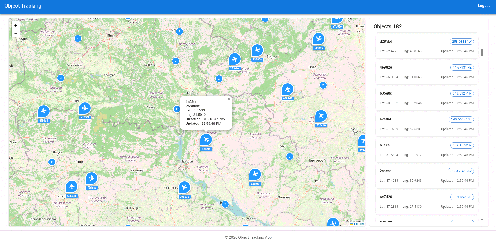

# Object Tracking Application

A full-stack web application for tracking objects on an interactive map with real-time updates. The application consists of a React frontend and a NestJS backend API.



## Quick Start

### Prerequisites

- **Node.js** 22 or higher
- **Yarn** 4 (enable it with `corepack enable`)

The repository contains two independent Yarn projects, `backend/` and `frontend/`; there is no root workspace, so every command below runs inside one of them.

### 1. Start the backend

```bash
cd backend
yarn install
cp .env.example .env
yarn start:dev
```

The API is available at `http://127.0.0.1:8000/api`, Swagger UI at the same address.

### 2. Start the frontend

In a second terminal:

```bash
cd frontend
yarn install
cp .env.example .env
yarn start
```

Open `http://localhost:3000` and log in with one of the keys from `VALID_API_KEYS` in `backend/.env` (`admin` or `qwerty` by default).

See [backend/README.md](backend/README.md) and [frontend/README.md](frontend/README.md) for all scripts and settings.

## Technology Stack

### Backend
- **NestJS** - Progressive Node.js framework
- **TypeScript** - Type-safe JavaScript
- **Swagger** - API documentation

### Frontend
- **React 19** - UI library
- **TypeScript** - Type safety
- **Material-UI** - Component library
- **React Leaflet** - Interactive maps

## Key Features

- 🗺️ **Interactive Map** - View objects on a map with marker clustering
- 🔄 **Real-time Updates** - Live object positions via Server-Sent Events
- 🔐 **Authentication** - API key-based authentication
- 📱 **Responsive Design** - Works on desktop and mobile
- 📚 **API Documentation** - Auto-generated Swagger docs

The backend simulates the objects: it generates them inside the polygon from `backend/map.kml` and moves them every 5 seconds. Objects that stop receiving updates disappear from the client after 5 minutes.

### API Integration

The frontend uses a TypeScript API client generated from the backend's OpenAPI specification with Orval. After changing backend endpoints or DTOs, start the backend and regenerate the client:

```bash
cd frontend
yarn orval
```

## License

This project is private and unlicensed.
